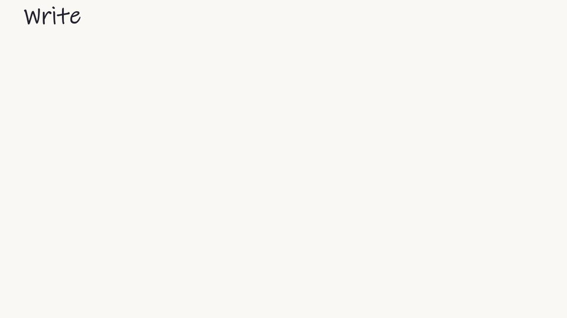

# worldhold: Holdfast, state programs for a world model

Hackathon Track 4 (World Models, Applied Reality), 14-15 November 2026.

**Question:** how long can a generated world hold together while an agent plays in it?

**What this is:** an open world model, [LingBot-World 2](https://github.com/Robbyant/lingbot-world-v2)
(14B, causal-fast), run on the [PlayWorld](https://github.com/kxding/PlayWorld) benchmark with a thin
controller that reads the model's state every 0.75 s and writes small corrections back into its
forward pass. No weights are changed and nothing is trained.

The method is called **Holdfast**. The set of writes it makes is a **state program**. Each write is small,
sits beside something the model already does, and can be switched off; with none of them the system is the
unmodified model. The writes that earned their place act at three levels of the model's state:

| Level of state | Write | Failure it fixes | Judged effect |
|---|---|---|---|
| Attention to text | Objective register | The model under-follows the request | Interaction 2.05 to 2.30 (171 cases) |
| Latents carried forward | Re-anchoring | The picture drifts over a long rollout | Insight 2.30 to 2.57 (30 cases) |
| Conditioning input | Shadow world, written back on return | The scene is not the same when the camera looks back | Geometry 2.48 to 2.82 (95 held-out cases, post hoc arm) |

Overall on the full 171-case benchmark: **2.31**, against 2.10 for the unmodified model and 2.12 published for
Genie 3. With the third write, on the held-out half: 2.40.

## Results

Judge: Gemini 3.1 Pro with PlayWorld's own prompts and contact sheets, on blinded folders. Player:
PlayWorld's agent protocol with Claude Haiku 4.5. Overall = mean of the four dimension means.

Published reference (PlayWorld paper, Table 2):

| Model | Geometry | Interaction | Insight | Out-of-sight | Overall |
|---|---|---|---|---|---|
| Genie 3 | 2.74 | 2.40 | 1.51 | 1.81 | 2.12 |
| LingBot-World 2 | 2.04 | 2.13 | 1.95 | 1.16 | 1.82 |

Ours:

<!-- RESULTS-TABLE -->
**Full benchmark, 171 cases** (`results/full_benchmark.json`): both arms on every case, blinded
together within each half.

| | Geometry | Interaction | Insight | Out-of-sight | Overall |
|---|---|---|---|---|---|
| Unmodified model, our driver | 2.35 | 2.05 | 2.30 | 1.68 | 2.10 |
| **Final state program** | 2.45 | 2.30 | 2.57 | 1.94 | **2.31** |
| Genie 3 (published) | 2.74 | 2.40 | 1.51 | 1.81 | 2.12 |

- Final minus unmodified, paired over 171 cases: **+0.22**, 95% bootstrap interval +0.03 to +0.40
  (62 cases better by more than 0.25, 40 worse). Every dimension moves up: geometry +0.10,
  interaction +0.25, insight +0.27, out-of-sight +0.25.
- The final program's overall has a 95% interval of 2.14 to 2.50. Genie 3's published 2.12 sits just
  below it. We are ahead on insight and out-of-sight and behind on geometry and interaction.
- The held-out half was judged twice and averaged; the development half once. The development half
  is where the configuration was chosen, so the held-out table below is the clean one; the two halves
  agree (2.34 and 2.31 for the final program, 2.15 and 2.10 for the unmodified model).

**Held-out half: 95 cases never used for development, all three arms on the same cases, blinded
together, two judging passes averaged per case** (`results/held_out.json`):

| Arm | Geometry | Interaction | Insight | Out-of-sight | Overall |
|---|---|---|---|---|---|
| Unmodified model, our driver | 2.40 | 1.89 | 2.19 | 1.92 | 2.10 |
| Objective in the prompt only | 2.66 | 2.04 | 2.11 | 2.13 | 2.24 |
| **Final state program** | 2.48 | 2.24 | 2.47 | 2.06 | **2.31** |

- Final minus unmodified, paired over the 95 cases: **+0.21**, 95% bootstrap interval -0.04 to +0.47
  (36 cases better by more than 0.25, 23 worse). By dimension: geometry +0.08, interaction +0.35,
  insight +0.28, out-of-sight +0.14.
- Final minus objective-only: +0.08 (-0.14 to +0.30). Most of the gain over the unmodified model is
  already there with the objective in the prompt; the registers, gate and re-anchoring add interaction
  and insight and give back some geometry.
- Against Genie 3's published 2.12 (171 cases): 2.31 on this half. Ahead on insight (2.47 vs 1.51) and
  out-of-sight (2.06 vs 1.81), behind on geometry (2.48 vs 2.74) and interaction (2.24 vs 2.40).
- Trajectory gate, out-of-sight cases (first pass): unmodified 8 pass / 7 partial / 6 fail; final
  12 / 5 / 4. Geometry cases: unmodified 16 / 7 / 1; final 13 / 7 / 4.
- The two judging passes of the same videos differ by 0.48 points per video on average; per pass the
  final arm's overall is 2.38 and 2.24, the unmodified model's 2.11 and 2.09.

**A second arm, designed after the held-out result was known** (`results/held_out_v2.json`). On first-person
cases it drops the caption gate and return register and adds the shadow world: when the camera turns away, the
generation state is forked and keeps running the view that was left; on return the arriving frame is pinned to
the fork's current frame through the model's image-condition input. Third-person and wait-and-observe cases run
the same program as before, so their videos and scores are reused; the 46 first-person cases were regenerated
and judged twice.

| Held-out half (95 cases) | Geometry | Interaction | Insight | Out-of-sight | Overall |
|---|---|---|---|---|---|
| Final state program (pre-registered) | 2.48 | 2.24 | 2.47 | 2.06 | 2.31 |
| With the shadow world (post hoc) | 2.82 | 2.26 | 2.47 | 2.04 | **2.40** |

Against the unmodified model: +0.30, 95% interval +0.02 to +0.60. Against the pre-registered program: +0.09
(-0.11 to +0.28), all of it geometry (+0.34), which moves past Genie 3's 2.74. Because this arm was chosen after
looking at held-out failures, 2.31 remains the figure we stand behind; 2.40 is what the same data says about the
revision. Its test on 11 development cases, before it was run here, gave +0.26 per case.

Development half (single judging, for reference): unmodified model 2.12 on 76 cases; objective in the
prompt 2.62 against 2.33 on 24 of them. That +0.3 shrank to +0.14 on the held-out half, which is what
selecting on a small noisy sample does.
<!-- /RESULTS-TABLE -->

How to read these: the benchmark has 171 cases. We drew a stratified half (76 cases, seed 20261114)
and did all development on it. The other 95 cases were not generated or looked at until the
configuration was fixed, and were run once.

**The judge is noisy, and we measured how noisy.** Several times a configuration produced a video
byte-identical to the baseline's, and the judge scored it again. Same video, same prompt:
1.0 / 5.0 / 4.2 on one case, 5.0 / 3.0 / 1.0 on another, 1.0 / 3.0 on a third (table in
`results/hillclimb_log.md`). A dimension mean over six cases cannot resolve a difference under about
a point. We therefore treat an unchanged video as a zero difference, pool repeat judgings of the
baseline (`loop/pool_baseline.py`), and report the held-out half rather than the development cases.

## Holdfast in three drawings


**Write 1, attention to the request.** The request gets its own segment in cross-attention and eight times the
attention, in all 40 blocks. The caption stays the base prompt. Third-person cases only.



**Write 2, the latents it carries forward.** After each 0.75 s chunk the mean of its latents is pulled halfway
back toward the first chunk's, before the chunk becomes context for the next.


**Write 3, what it sees when it looks back.** When the camera starts to turn away, the whole generation state is
copied. The copy keeps generating the view that was left. When the camera turns back, the arriving frame is
pinned to the copy's current frame through the model's own "this frame is given" input.

Rebuild the drawings with `python -I scripts/make_explainers.py`.

## Why the model breaks (from its code and the judge's words)

1. **It under-uses the text.** Told that the woman walks up the slope, it often does something nearby.
2. **It forgets in three seconds and does not know where it is looking.** Self-attention keeps 12
   rolling latent frames plus the episode's first six. Camera input is frame-to-frame relative, so
   after a turn nothing tells the model it is facing the start again.
3. **The caption describes the starting view for the whole episode.** While the camera looks away,
   those words keep painting the starting subject into frame. The judge then reports "the camera
   stayed still" or "it kept turning and never came back", and the case scores 1 at the trajectory
   gate. On the development half, 7 of 22 out-of-sight cases failed that gate and 7 more passed it
   only partially; the ones that passed averaged 1.91, above Genie 3's 1.81.
4. **It drifts.** Over 30 seconds colours slide (one hall goes from red to deep blue).

## The state program

| Write | Where in the model | Applies to | Evidence |
|---|---|---|---|
| **Objective register** | The objective is encoded as its own cross-attention segment; `log(8)` is added to the attention logits of its tokens in all 40 blocks. The caption stays the base prompt | Third-person cases | Dose-response on six cases (gain 1 = no effect, 4 and above completes the action); seven further cases not used to choose it: 4.0 vs 3.2 (orchestrator's frame scores) |
| **Objective in the prompt** | Appended to the caption at normal strength, as PlayWorld's own local adapter does | First-person cases | Gemini: 2.62 vs 2.33 on 24 cases |
| **Caption gate** | The caption moves into a register whose gain follows the measured heading: 1 when facing the start, falling to 0.1 at 60 degrees away. The base prompt is a neutral line about the surroundings | First-person cases with camera motion | Frames: on three cases that failed the gate, the away views become plain surroundings and the subject reappears on return |
| **Return register** | A sentence for how the same entity looks a few seconds later, written at step 0 from the first frame, the caption and an Exa answer. Silent (gain 0.01) while away, ramped to 4 as the heading returns | First-person scenes with something mid-process | Frames: 2 of 4 cases better (the red tram is kept instead of replaced; one man and dog instead of a duplicate), 2 unchanged |
| **Latent re-anchoring** | Each chunk's per-channel latent mean is pulled halfway back to the first chunk's | Everything | Frames: the 30 s hall keeps its colours; no harm on a clean 30 s scene |

The program for a case is chosen from fields the generator may read: `perspective` and the
objective text. "Wait and observe" cases get re-anchoring only.

Heading is measured, not assumed: a SIFT homography between consecutive chunks gives the rotation
the frames actually show (`odometry.py`), accumulated from the start of the episode.

### Self-repair loop (built, optional, not in the reported run)

`repair.py`: after a rollout a Claude Haiku critic (`critic.py`), given only the caption, objective,
perspective and frames, rates action, subject, picture and liveliness. The verdict selects one edit
to the program (halve the register gain if the subject or picture was lost, double it if the action
did not happen, add a gentle residual "alive" write if the scene froze), up to three attempts, best
kept. The winning program is written to past.dev and later episodes start from the one recalled for
the most similar scene. Checked against the orchestrator's judgments on 40 videos: the critic agrees
on gross outcomes and misses subtle ones (it did not notice a first-person car interior disappearing).

## What did not work

Each of these was built, run and looked at; details and sweep names are in `results/hillclimb_log.md`.

| Tried | Outcome |
|---|---|
| A Claude "director" rewriting the prompt as the scene progressed | -0.11 overall on 76 cases (95% CI -0.46 to +0.23); prompt switches cause hard resets |
| One Exa-grounded motion sentence added to the caption at step 0 | 1.88 vs 2.33 on 24 cases |
| Shadow rollout of the unseen start view; watchdog rollback on latent resets and freezes | No gain |
| Rotation memory pasted into the latents on return | Its early "+0.3 on geometry" did not survive the judge's noise |
| Cross-attention masks tying text to image regions | Worse |
| Attention gain on the model's first frames, 2x to 1000x | No effect up to 16x; smears at 1000x. A direct measurement shows the model already puts about a fifth of its attention there, and blocking them stops it finding its way back |
| A heading-indexed bank of evicted views written back into those slots | No visible effect |
| Larger attention window (30 to 42 frames) | Runs; no gain |
| Camera guidance (extrapolating each block's camera scale and shift away from a still camera's) | Executes an ignored strafe and turns "drove along the bridge" into a pan in place, but over-rotates cases that were fine |
| Residual-stream steering from judged runs | Only the interaction direction passed a held-out sign test (5 pairs). Written on all sampling steps it collapses into colour; on steps 0-1 only it is clean and raises motion threefold, with a mild effect on what is scored |
| Forward speed above 1.0 | Noise: the model's translation input is normalised to a maximum of 1.0 |
| Keyframe arrival pinned to the first frame | Clean when it fires. Triggered from the start pose only, it rarely fired; triggered from wherever the camera stood (the shadow world), it is the third write |
| Object ledger: write-back limited to the regions an agent calls static, Exa sentence for the rest | 1.55 vs 1.88 for the whole-frame write-back on 11 cases; the subject left unpinned stayed frozen. Its critic called every object fine on cases the judge scored 1 |
| Launch-time planner (a small LLM choosing the program) | 1.59 vs 2.19 on 21 cases: its menu described the alive write as a fix, so it switched it on everywhere |
| Motion written into the starting noise (frames warped by the commanded move) | Ran on every commanded chunk; no advance on the stuck cases |
| Steering only the unseen copy with the Exa sentence (shadow world) | 2.16 vs 2.05 on 14 cases, interval -0.77 to +0.95: large swings both ways, not distinguishable from no effect |
| Predicting the judge from recorded activations and latent reads | At or below chance at picking the better of two reruns (0.41-0.44 over 238 pairs), although a perfect picker would gain +0.92 |

## Where it still breaks

- **Walking forward from a standing start on real photographs.** On a shopfront, a rocket pad and
  the Sphinx the player presses forward and nothing advances. Nothing we tried moved it.
- **Out-of-sight change is told, not simulated.** The return sentence is fixed at step 0 and assumes
  "about eight seconds later" however long the camera was actually away.
- **Geometry after translation.** Heading is measured; position is dead-reckoned in steps. There is
  no depth-based memory, so a remembered view cannot be reprojected from a new position.
- **The critic is weak on fine defects**, so the repair loop helps with clear failures only.
- **Most of the night's evidence is frame-reading by the orchestrating model**, not judge scores. The
  held-out run is the only place those choices are tested by the benchmark's judge.

## How it was developed

A model in the driver's seat (Claude, as the orchestrating agent) ran the loop by hand: launch a
sweep of one write at several strengths, pull frame strips (`scripts/view_grid.py`), score them
against the public rubric wording, keep, drop or debug. Three results came from debugging rather
than tuning: residual writes were collapsing because they were applied on the sampling steps that set
colour; the attention-gain patch had been installed in a module the fast model does not use (the run
logged zero applications); and the heading used by the new writes restarted at every walk step.
Every write records how many times it was actually applied, so a silent no-op shows up as a zero.

## past.dev challenge

### Agents

Nine identities read and write through one module, `tools/mem.py`. Every write carries its author as
`identity` and one audience; every recall sends the reader's identity. Each call is appended to
`results/memory_log.jsonl`.

| Agent (identity) | Runs | Writes (audience) | Reads | Audiences it is in |
|---|---|---|---|---|
| `controller` | In the episode (`episode.py`, `repair.py`) | Measured turn gain; the winning state program per scene (`wh-programs`) | Turn gain; the program that won on the most similar scene; the critic's defects; the director's sentence it applies | `wh-world`, `wh-programs` |
| `cartographer` | Step 0 (`outsight.py`, `brief.py`) | The Exa question, answer and source URL for how fast a scene's process advances (`wh-world`) | | `wh-world` |
| `director` | Step 0 | The sentence for the state on return, derived from the cartographer's fact (`wh-world`) | | `wh-world` |
| `composer` | Step 0 of a later episode | | The director's stored sentence for this scene, instead of asking Exa again | `wh-world` |
| `critic` | After a rollout (`repair.py`) | The worst defect it saw and the program that produced it (`wh-programs`) | | `wh-programs` |
| `planner` | At launch (`planner.py`) | Its chosen program and reason (`wh-programs`) | Beliefs, measurements and rules about each control, written by the proposer, experimenter and critic | `wh-programs` |
| `proposer`, `experimenter` | The development loop (`loop/hillclimb.py`) | Each trial's hypothesis and judged outcome (`wh-lab`); conclusions published as belief, measured or rule (`wh-programs`) | Past lessons before proposing | `wh-lab` |
| `scout` | The self-improvement loop (`loop/scout.py`) | Sourced, untested proposals from Exa (`wh-lab`) | | `wh-lab` |

Reads across agents: the composer uses the director's sentence; the controller uses the critic's defects
and its own earlier programs; the proposer uses the experimenter's lessons.

### Layers

Three read boundaries, one audience each (`AUDIENCES` in `tools/mem.py`):

- **`wh-world`, semantic, about scenes**: sourced facts about how real processes behave (each with its
  Exa URL) and the sentence derived from each. Facts and sentences are separate records so a fact can
  be reused and a sentence can be replaced without losing its source. Shared by the scene agents and
  the controller that applies the sentence.
- **`wh-programs`, procedural, about the model**: calibration (achieved over commanded turn), which
  state program worked on which kind of scene, and the defects the critic saw. Only the controller
  and critic are in it: a scene agent has no use for "gain 8 worked", and seeing it would invite it
  to write captions around the mechanism.
- **`wh-lab`, episodic, about our own experiments**: hypotheses and judged outcomes. Kept out of
  running episodes on purpose, so nothing learned from the judge can leak into generation.

Not in past.dev: working state (headings, latents, the view bank) stays in the process. It is large,
changes every 0.75 s and means nothing to another episode. Every trial and sweep is also written to
`results/hillclimb_log.md` for people to read.

Expected before running: the world layer would save Exa calls on repeated scenes and make the
return sentence consistent across runs; the programs layer would let a new episode start from a gain
that worked.

### Results

- **A stored fact changes generation.** Cartographer's Exa fact, director's sentence, composer's
  recall, then the sentence enters the model as a cross-attention register that ramps in when the
  camera returns. On two of four cases this changed the returned view from a replaced or duplicated
  subject to the original one, moved on (frames; see The state program).
- **Read boundaries hold, and supersession shows up** (`tools/mem_demo.py`, output in
  `results/pastdev_demo.txt`). The controller recorded the register gain for third-person cases as 4
  at 00:45 and as 8 at 01:10, which is what happened. Asked the same question:
  the controller gets both records, the extracted claim "gain 4 (exactly)" carrying
  `supersededAt: 2026-11-15T09:10:00Z`, the critic's defect about gain 16, and for each the source id
  and the excerpt it rests on; the composer (`wh-world` only) and the proposer (`wh-lab` only) get
  none of those sources.
- **A refuted belief changed another agent's decisions** (`tools/planner_memory_demo.py`, output in
  `results/pastdev_planner_demo.txt`). The proposer published a belief at 05:10 that the residual "alive" write
  fixes frozen scenes. A planner that trusted it switched the write on everywhere and scored 1.59 against 2.19.
  The experimenter published the two judged measurements and a rule ("alive must be 0 until a judged test shows a
  gain"). The planner now builds its menu from memory, where each note carries its author, kind (belief,
  measured, rule) and date. Reading the memory as it stood at 05:30 (past.dev's `queryTimestamp`) it turns the
  write on for 8 of 8 cases; reading it now, for 0 of 8, and in both it obeys the critic's earlier rule on the
  action register. Agents outside the `wh-programs` audience see none of these records.
- **The repair loop reads a winning program back** as the first attempt for a similar scene.

### Caveats

- Audiences were added late. Records written before 03:20 on 15 November carry no audience and are
  project-visible to every identity; only later writes are scoped.
- Recall does not return the author, so the author is also written into the text and the source label.
- We have not shown a later episode scoring better because of a recalled program or sentence: the
  loop ran on a handful of cases with an almost empty memory, and the reported benchmark run does
  not use the repair loop. Recalled sentences make runs repeatable; that is all we can claim.
- Supersession is shown on one fact that we wrote twice on purpose (truthfully). In episodes, a
  re-run of a scene overwrites nothing; it adds a record.
- Deleting a source is not wired in. A wrong fact written by the cartographer stays until removed by hand.
- Early writes in the proposer and experimenter roles were made by the orchestrating model acting in
  that role, not by a separate process.
- The agents are roles within one program run, sharing one API key; identity is declared by the
  caller, not authenticated per agent.

## Exa challenge

Exa is called in three places. Every call is logged with its query and the URLs it returned
(`results/exa_log.jsonl` for calls made from this machine; calls made inside generation are collected from the
run results into `results/exa_sources_final.jsonl`).

**1. Inside every first-person episode (the main loop): `adapters/lingbot/outsight.py`, `exa_search.answer`.**
At step 0 an agent names the thing in the first frame that is mid-process and asks Exa how far that process
advances in about ten seconds. The answer becomes one sentence that enters the model as a cross-attention
register: silent while the camera is away, ramped in as the measured heading returns. It is not pasted into the
prompt. `results/exa_sources_final.jsonl` has, for each of the 52 episodes of the reported runs that used it, the
question, Exa's answer, the source URL, the sentence written, and on how many chunks the register was active.

**2. In the self-improvement loop: `loop/scout.py methods`, `/search` restricted to 2025 onwards.** The scout
reads how the final program still fails (the judge's summaries on the held-out half, grouped into failure modes:
replaced on return 21, frozen 11, hard cut 9, trajectory not executed 6, no evolution out of view 2 cases), searches for recent work on each mode,
and has a small model map each hit onto one of the controller's write ports, or say it needs new code. A
proposal must point at a URL Exa returned. This run produced 15 proposals from sources dated 2025-06-03 to
2026-10-16, all later than anything the orchestrating model could know from training: `results/scout_report.md`.
Several describe, from the literature, interventions this project had already built and judged (camera-motion
guidance, a deeper attention sink, a shadow rollout of the off-screen region, memory retrieval for revisits), and
the report says for each port what we measured. Proposals are stored in past.dev as untested hypotheses; only a
judged measurement lets the planner act on one.

**3. Checking what we quote: `loop/scout.py claims`, `/contents`.** The reference numbers in this README
(Genie 3 at 2.12 with its four dimension scores, Matrix-Game-3.0 at 1.14, 171 cases, and the weight-space
programming result that redirected the project) are fetched from the live arXiv page, the project page and the
blog and matched against the text: `results/scout_claims.json`. All four were found.

What search does that the models could not: the benchmark (August 2026) and the weight-space programming post
(2 November 2026) are both newer than the orchestrating model's knowledge. The post was found by web search
during the hack and led directly to the residual-stream experiments and to the framing that an edit can remove
an obstacle but not add an ability; the scout now reproduces that lookup through Exa with the source checked.

What we cannot claim: that search raised the benchmark score. The arm with the Exa-derived return sentence did
not beat the objective-only arm on out-of-sight (2.06 vs 2.13 on the held-out half). In three of the 52 episodes
the scene agent named the camera itself as the thing in progress, because it was handed the caption with the
objective appended; that is fixed in the code and was not re-run. The scout's proposals that map onto untested
ground (frequency-domain anchoring of latents, separate anchor and local cache tracks) have not been tried.

## Modal

`modal_app/wh_modal.py`: weights and benchmark data on a volume, generation fanned out over H200s
from inside Modal (so a run survives the launching machine going offline), several configurations
per model load for sweeps, and activation replay of finished videos.

```bash
modal run -d modal_app/wh_modal.py::download
modal run -d modal_app/wh_modal.py::generate_bg --job-json '{"cases": [...], "modes": ["open"], "out": "run1", "player": 1, "cfg": {...}}' --shards 4
modal run modal_app/wh_modal.py::judge_inputs --run run1
modal volume get worldhold-runs judge/run1/lingbot2_14b_open runs/jin_run1/
python eval/blind.py runs/jin_run1 runs/jblind_run1 0
python eval/openrouter_judge.py --inputs runs/jblind_run1 --out runs/gem_run1 --transport gemini
python eval/tally.py ...
```

The final configuration and the case split are in `results/final1_plan.json`. Keys go in `.env`
(`ANTHROPIC_API_KEY`, `EXA_API_KEY`, `PAST_API_KEY`, `GEMINI_API_KEY` or `OPENROUTER_API_KEY`).

## Layout

```
adapters/lingbot/  stepper (chunk driver and all state writes), episode (controller), odometry,
                   outsight / brief (Exa + past.dev agents), critic, repair, camguide, acts, player
eval/              judge inputs, blinding, Gemini judge (direct or OpenRouter), tally
loop/              judged hill-climb, baseline pooling, direction extraction
modal_app/         generation, sweeps and replay on Modal
scripts/           frame-strip viewer and small tools
tools/             past.dev, Exa and Claude clients
results/           hillclimb_log.md (every trial and sweep), case splits, logs of memory and Exa calls
```

## Rules we hold ourselves to

- Generation code reads only a case's image, caption, objective, perspective and action sequence
  (`ALLOWED_CASE_FIELDS` in `episode.py`). The rubric is read only by `eval/judge_prep.py`.
- Judges see shuffled, anonymised folders.
- The held-out half was run once, after the configuration was fixed.
- LingBot-World 2 weights are CC BY-NC-SA; this repository contains no weights.

See `docs/references.md` for sources.
