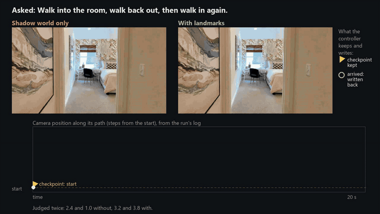

# Holdfast — programming a world model's hidden state, without changing a single weight

> I took an open world model (LingBot-World 2), **trained nothing and changed no weights**, and made it score **2.31 on PlayWorld**, above the **2.12 published for Genie 3**, by reading and writing what is inside the model while it runs. **Exa** feeds it real-world facts as it generates, **past.dev** is its memory between runs, and every rollout ran on **Modal**.

Built for the SF AI research hackathon, **Track 4: World Models**. Challenges: **Exa**, **past.dev**, **Modal**.

---

Hey judges!

This repo has a whole weekend of experiments in it, and nobody wants to read all of that. So here is the short way through.

# I propose:

A 5 minute plan to see what this is and whether it is real.

# Without further ado, this is Holdfast:

WHY you should consider this to win:

1. **It beats a closed model with an open one, and no training.** With the same judge, same 171 cases as the github: the untouched model scores 2.10, Holdfast scores 2.31. Genie 3's published score is 2.12. (we beat Genie!!)
2. **The gains come from inside the model.** You may have heard of weight-space programming (editing a model's weights like code). This is the same idea one level up: I edit the model's *hidden state*, the working memory it uses while it generates. Each edit fixes one problem you can see on screen. I find it super interesting!
3. **I tested it the hard way.** I picked the settings on half the benchmark, then ran them once on the other half I had never looked at. The gain held. Everything that did *not* work is written down too (there is.. a lot of it).

Now, here is how to experience this project:

**1. Watch the demo video** (2 min). It is on the hackathon submission page.

**2. Look at the three pictures below** (2 min). Each one is a problem and its fix.

**3. Skim the results table** (1 min). Then, if you want every number and every failed idea, read [`docs/DETAILS.md`](docs/DETAILS.md).

---

## The problem, in plain words

A world model is a video model you can walk around in. LingBot-World 2 is a good open one, but it has three habits that break the illusion:

- **It does not listen.** You ask the character to walk into the pond, and she walks past it.
- **It drifts.** Over 30 seconds the colours slide, like a photocopy of a photocopy.
- **It forgets.** It only remembers about 3 seconds. Look away and back, and it makes up a new room.

## The fixes

I never retrain the model. A small controller sits around it, and every 0.75 seconds it reads what is inside and writes a small correction back in.

### Fix 1: make it listen (a write into its attention)


*Asked: "the character walks left into the pond." Left: untouched model. Right: with the fix.*

The request is a few words buried in a long scene description, so the model barely notices it. I give the request its own slot and turn its volume up 8 times. **Interaction score: 2.05 to 2.30.**


### Fix 2: stop the drift (a write into what it carries forward)


*30 seconds in a sculpture hall, sped up. Left: untouched model. Right: with the fix.*

The model builds each piece of video on top of the last one, so small errors pile up. After every piece I pull its overall tone halfway back toward where it started. The content is still free to change; only the slow slide is corrected. **Insight score: 2.30 to 2.57.**


### Fix 3: give it a memory (checkpoints, written back when you return)



*"Walk into the room, walk back out, walk in again." The plot at the bottom is drawn from the run's own log: a flag where the controller saved a checkpoint of the model's state, a green ring where it wrote one back.*

Every time the camera stops or changes direction, the controller saves a checkpoint of what the model was showing. When the camera comes back to that spot, the checkpoint is handed back to the model through the same input it uses for its very first frame.

Being straight with you: this one fixes individual cases (you can see it), but across fresh cases it did **not** raise the average score, so it is **not** part of the 2.31. It is the part I would keep working on.


## Results

Judge: Gemini 3.1 Pro with PlayWorld's own prompts, on videos with the names hidden and shuffled.

| All 171 PlayWorld cases | Geometry | Interaction | Insight | Out-of-sight | Overall |
|---|---|---|---|---|---|
| LingBot-World 2, untouched (our judging) | 2.35 | 2.05 | 2.30 | 1.68 | 2.10 |
| **Holdfast** | 2.45 | 2.30 | 2.57 | 1.94 | **2.31** |
| Genie 3 (published) | 2.74 | 2.40 | 1.51 | 1.81 | 2.12 |

- **Holdfast against the untouched model, case by case: +0.22** (95% interval +0.03 to +0.40). 62 cases better, 40 worse.
- On the **95 cases I never used for development**: 2.10 to 2.31 as well.
- Three things make up the gain: **telling the model what was asked** (the benchmark setup leaves the request out of the prompt; this is the biggest piece and it is a plain prompt change), **Fix 1**, and **Fix 2**.
- Two honest notes. The PlayWorld paper lists LingBot-World 2 at 1.82; under our judging the same untouched model gets 2.10, so the fair comparison is 2.10 to 2.31. And Genie 3's 2.12 is their published number; I could not run Genie 3 myself.

## Exa: real-world facts, written into the model as it runs

At the start of an episode the controller looks at the first frame and asks **Exa** how the thing in it really behaves. Example from the scored run:

- **Question to Exa:** "How far can a Labrador Retriever walk in 10 seconds at a typical walking pace?"
- **Exa's answer, with its source:** 7.8 to 11.6 metres, from a gait study in the *American Journal of Veterinary Research*.
- **What gets written into the model:** "The yellow Labrador on the leash is now positioned further down the road, approximately twenty-five to thirty-eight feet ahead of where it started..."

That sentence goes into the model's attention as its own slot, kept silent while the camera looks away and switched on as it turns back. This ran in **47 of 52** first-person episodes of the scored run, each with a source link ([`results/exa_sources_final.jsonl`](results/exa_sources_final.jsonl)).

Exa also finds recent papers for each kind of failure the judge reports ([`results/scout_report.md`](results/scout_report.md)) and checked the numbers quoted here against their live sources: 4 of 4 confirmed ([`results/scout_claims.json`](results/scout_claims.json)).

Straight talk: Exa-sourced writes are part of the 2.31 program, but tested on their own they did not add to the score. I likely need some more testing to figure this out.

## past.dev: the model's memory between runs

Nine small agents work around the model (a planner, a critic, an experimenter and so on). **past.dev** is the memory they share.

- **It remembers scenes.** The first time a scene is seen, one agent stores what Exa found. The next time, another agent recalls it in **about 1 second instead of 7**, with no search at all ([`results/pastdev_scene_cache.json`](results/pastdev_scene_cache.json)).
- **It decides what gets written into the model.** Before every run, the planner reads what other agents *measured* and picks the settings. One agent believed a certain write fixed frozen scenes. Another measured it: the score dropped from **2.19 to 1.59**. past.dev marked the belief as replaced, and the planner stopped using that write on **8 of 8** scenes.
- **It makes the planner more accurate, cheaply.** With past.dev the planner gets **92%** of its settings right, against **77%** with no shared memory, using about **a fifth of the prompt** that pasting the whole log would need ([`results/pastdev_bench.md`](results/pastdev_bench.md)).

Straight talk: looking things up adds a round trip, so past.dev was *not* faster than pasting the whole log into the prompt at our log size. But, it was cheaper and nearly as accurate, and one of the first times I've ever seen a memory service meant for llms be used in a world model!

## Modal: every experiment

Every rollout ran on Modal H200 GPUs: about 35 sweeps over the weekend, up to **19 GPUs at once!!**

## Run it

```bash
# one case, untouched model against Holdfast (needs a Modal account and the model weights on a Modal volume)
modal run modal_app/wh_modal.py::generate --job-json '{"cases":["IF006"],"modes":["open"],"out":"try1","variants":{"unmodified":{},"holdfast":{"prompt":"caption+objective","register":{"gain":8,"when":"third person","replace":true},"anchor_stats":0.5}}}'

# any photo of your own, side by side with the checkpoint visualizer (about 9 minutes)
python -I -X utf8 scripts/live_demo.py my_photo.jpg --action "w*6 -> s*6"
```

There is also a live web page ([`modal_app/live_app.py`](modal_app/live_app.py)): upload any photo, pick a camera path, and two Modal GPUs generate the untouched model and Holdfast side by side (about 75 seconds once warm). It is deployed with `modal deploy modal_app/live_app.py` behind an access code.

Keys go in a `.env` file that is not in this repo.

## Repo map

| Path | What |
|---|---|
| [`adapters/lingbot/stepper.py`](adapters/lingbot/stepper.py) | Runs the model piece by piece and makes every write into it |
| [`adapters/lingbot/episode.py`](adapters/lingbot/episode.py) | The controller: decides what to write and when |
| [`adapters/lingbot/outsight.py`](adapters/lingbot/outsight.py) | Exa inside the run, with past.dev scene memory |
| [`adapters/lingbot/planner.py`](adapters/lingbot/planner.py) · [`debugger.py`](adapters/lingbot/debugger.py) | Agents that pick and repair the settings from past.dev |
| [`tools/mem.py`](tools/mem.py) | The past.dev layer: nine agents, three read boundaries |
| [`eval/`](eval/) | Hidden-name judging, held-out split, tallies |
| [`results/`](results/) | Every score, log and sweep |
| [`docs/DETAILS.md`](docs/DETAILS.md) | **The full write-up**: every table, every failed idea, how it was developed |

## Credits

Built on [LingBot-World 2](https://github.com/Robbyant/lingbot-world-v2) and the [PlayWorld](https://github.com/kxding/PlayWorld) benchmark. Search by **Exa**, memory by **past.dev**, compute by **Modal**, judging by Gemini 3.1 Pro.

# FAQ

1. **Did you train or fine-tune anything?** No. Not one weight changes. Switch the writes off and you have the original model.
2. **Is "beats Genie 3" a fair claim?** 2.31 against their published 2.12, yes. I could not run Genie 3 through my own judging, (google doesn't give an API as far as I know, so I used the published score from playworld)
3. **Is it all hidden-state programming?** No. One of the biggest pieces is simply telling the model what was asked. In addition, the two hidden-state writes add the interaction and insight gains on top.
4. **What did not work?** About twenty things, including the memory checkpoints as a score gain, steering the model's internal activations directly, and several ways of using Exa's answers. They are all in [`docs/DETAILS.md`](docs/DETAILS.md) with their numbers.
5. **What still breaks?** A person standing still in a real photo will not start walking, whatever I write. And things that should change while you are not looking come back unchanged.

# That's it! Thank you for hosting this, and I hope it was a fun one to read :)
